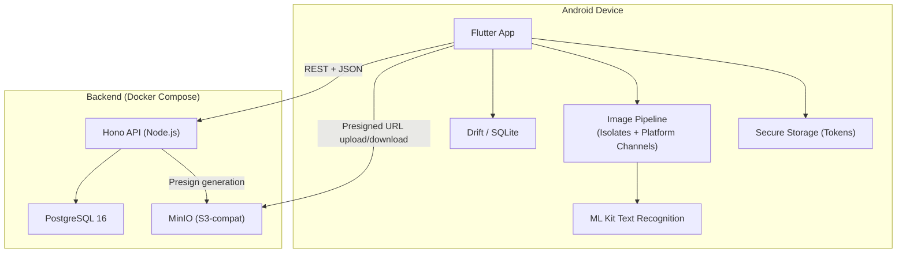

# Boored — Architecture Summary, Package List & Risk Assessment

> **Review this document and approve before any code is written.**
> Flag anything you want changed. The 5 open questions at the end need your input.

---

## 1. Architecture Overview



### Data Flow

1. **Capture** — Camera fires at interval → raw frame → image pipeline (perspective transform, enhance, lecturer removal) → cleaned keyframe saved to app-private storage + Drift DB.
2. **Final pass** — Dedup keyframes → ML Kit text extraction → timeline JSON → PDF generation → all stored locally.
3. **Sync** — Outbox queue pushes metadata to Hono API → PostgreSQL. Files upload via presigned URLs to MinIO/S3. Pull fetches remote changes by cursor.
4. **Auth** — Google Sign-In → ID token → Hono verifies against Google JWKS → issues JWT access token + rotating refresh token.

### Monorepo Structure

```
Boored/
├── apps/
│   ├── mobile/          Flutter (Android)
│   └── api/             Hono + TypeScript
├── packages/
│   ├── db/              Drizzle schema, migrations, client
│   └── contracts/       Zod schemas, OpenAPI spec output
├── infra/               docker-compose.yml, env templates
├── docs/                ADRs, architecture, setup guide
├── .github/workflows/   CI pipelines
├── pnpm-workspace.yaml
├── package.json         Root scripts
├── .editorconfig
├── .gitignore
└── .env.example
```

**Tooling**: pnpm workspaces for the TypeScript packages (`apps/api`, `packages/db`, `packages/contracts`). Flutter lives alongside but is not managed by pnpm.

---

## 2. Package List

All versions verified against npm / pub.dev on 2026-11-10.

### 2.1 Backend (Node.js / TypeScript)

| Package | Version | License | Why |
|---------|---------|---------|-----|
| `hono` | 4.13.x | MIT | Web framework — fast, small, middleware-composable. CORS, logger, secure headers are built-in (`hono/cors`, `hono/logger`, `hono/secure-headers`). |
| `@hono/node-server` | 2.1.x | MIT | Node.js HTTP adapter for Hono. |
| `@hono/zod-openapi` | 1.6.x | MIT | Route-level Zod schemas that auto-generate an OpenAPI 3.1 spec. Every route validated and documented from one source. |
| `@scalar/hono-api-reference` | 0.12.x | MIT | OpenAPI docs UI (dev only). Modern alternative to Swagger UI. |
| `zod` | 4.6.x | MIT | Runtime validation + TypeScript inference. v4 confirmed compatible with `@hono/zod-openapi` 1.6.x. |
| `drizzle-orm` | 0.45.x | Apache-2.0 | Type-safe SQL ORM. Supports custom column types for `tsvector`, generated columns, GIN indexes. |
| `drizzle-kit` | 0.31.x | MIT | Migration generation and push. |
| `postgres` | 4.1.x | Unlicense | postgres.js driver — the recommended Drizzle driver for modern TS. Lighter than `pg`, cross-runtime. |
| `jose` | 6.2.x | MIT | JWT signing/verification and Google ID token verification via JWKS. Lighter than pulling in the full `google-auth-library` SDK. |
| `@aws-sdk/client-s3` | 3.x | Apache-2.0 | S3/MinIO bucket operations. |
| `@aws-sdk/s3-request-presigner` | 3.x | Apache-2.0 | Presigned upload/download URL generation. |
| `nanoid` | 6.x | MIT | Short unique IDs for tokens and internal identifiers. |
| `hono-rate-limiter` | 0.5.x | MIT | Community rate-limiter for Hono. In-memory for dev; swap to Redis-backed store in production. |
| `vitest` | 5.1.x | MIT | Unit and route tests. |
| `@testcontainers/postgresql` | 12.2.x | MIT | Spin up real Postgres containers for integration tests. |
| `typescript` | 5.x | Apache-2.0 | Language. |
| `tsx` | latest | MIT | TypeScript execution for scripts and dev server. |

**No extra CORS/logger/secure-headers packages** — all built into Hono core.

### 2.2 Flutter (Dart)

| Package | Version | License | Why |
|---------|---------|---------|-----|
| `google_sign_in` | 7.2.x | BSD-3-Clause | Google auth on Android. v7 uses singleton API with explicit `.initialize()`. |
| `flutter_secure_storage` | 11.2.x | BSD-3-Clause | Encrypted token storage backed by Android Keystore. |
| `dio` | 5.11.x | MIT | HTTP client with interceptors (auth refresh, retry, timeout). |
| `retrofit` | 4.10.x | MIT | Type-safe API client generated from OpenAPI spec via `swagger_parser`. |
| `retrofit_generator` | 10.1.x | MIT | Code gen for Retrofit clients (dev dependency). |
| `flutter_riverpod` | 3.5.x | MIT | State management (see justification in §3). |
| `riverpod_annotation` | 4.0.x | MIT | Annotations for Riverpod code gen. |
| `riverpod_generator` | 4.0.x | MIT | Provider code generation (dev dependency). |
| `drift` | 2.35.x | MIT | Type-safe SQLite ORM. Reactive streams, compile-time queries, migration support. Uses `drift_flutter` for DB init. |
| `camera` | 0.12.x | BSD-3-Clause | Camera access and preview (CameraX backend on modern Android). |
| `google_mlkit_text_recognition` | 0.17.x | MIT | On-device OCR behind a `RecognitionEngine` interface. |
| `pdf` | 3.13.x | Apache-2.0 | PDF document generation. |
| `pdfx` | 2.11.x | MIT | In-app PDF rendering. Multi-platform, renders pages as images with pinch-zoom. |
| `share_plus` | 13.3.x | BSD-3-Clause | Share files via OS share sheet. v13 uses `SharePlus.instance.share()` API. |
| `go_router` | 18.1.x | BSD-3-Clause | Declarative routing with deep link support. Official Flutter team package. |
| `path_provider` | 2.1.x | BSD-3-Clause | App-private and cache directory paths. |
| `permission_handler` | 12.0.x | MIT | Runtime permission requests (camera). |
| `wakelock_plus` | 1.6.x | BSD-3-Clause | Keep CPU/screen awake during capture. |
| `flutter_foreground_task` | 11.0.x | MIT | Foreground service for long capture sessions with persistent notification. |
| `freezed_annotation` | 3.1.x | MIT | Immutable data class annotations. |
| `freezed` | 4.0.x | MIT | Immutable data class code gen (dev). |
| `json_annotation` | 4.x | BSD-3-Clause | JSON serialization annotations. |
| `json_serializable` | 6.15.x | BSD-3-Clause | JSON code gen (dev). |
| `build_runner` | 2.17.x | BSD-3-Clause | Dart code generation runner (dev). |
| `swagger_parser` | 1.46.x | MIT | Generates Retrofit + Freezed Dart client from OpenAPI JSON spec. Pure Dart, no Java needed. |

**Image processing (OpenCV)**: Native Kotlin + OpenCV Android SDK 4.x (BSD-3-Clause) via platform channels. Not a pub.dev package — downloaded as an Android AAR. See justification in §3.

### 2.3 Infrastructure

| Tool | License | Role |
|------|---------|------|
| PostgreSQL 16 | PostgreSQL License (permissive) | Primary database |
| MinIO | **AGPL-3.0** | S3-compatible object storage, local dev only |
| Docker Compose | Apache-2.0 | Local infra orchestration |
| pnpm 10.x+ | MIT | Package manager + workspaces |

> **MinIO AGPL note**: We run MinIO as a standalone Docker container and never link to or modify its source. AGPL does not apply to our application code. In production, you'd use AWS S3 or Cloudflare R2. If AGPL in the dev stack is still a concern, LocalStack (Apache-2.0) is the alternative, but MinIO is more reliable for S3 compat testing.

### 2.4 API Client Generation Pipeline

```
Zod schemas (packages/contracts)
        ↓
@hono/zod-openapi routes (apps/api)
        ↓
OpenAPI 3.1 JSON spec (/v1/openapi.json)
        ↓  export script copies to apps/mobile/
swagger_parser (pure Dart)
        ↓
Retrofit client + Freezed models (apps/mobile/lib/generated/)
```

Single source of truth = Zod schemas. Change a schema → re-export spec → re-generate Dart client → compiler catches any breakage.

---

## 3. Key Design Decisions

### Riverpod over Bloc

Chosen: **Riverpod**. Reasons:
- Less boilerplate — no event/state class ceremony for simple state
- Code-gen makes providers type-safe and auto-disposed
- Provider overrides give clean dependency injection for testing
- Compile-time safety on provider dependencies (no runtime `ProviderNotFoundException`)
- Bloc adds structure that pays off in large teams with strict patterns, but Boored is a data-heavy app with many independent reactive streams (notes list, sync status, capture state, processing progress) where Riverpod's granular reactivity fits better

### OpenCV via Platform Channels (not opencv_dart)

Chosen: **Native Kotlin + OpenCV Android SDK via platform channels**.

`opencv_dart` (1.4.x) exists on pub.dev but:
- Relatively young, limited production usage reports
- FFI bridge stability varies across Android versions and architectures
- Limited docs for advanced ops (perspective transforms, morphological operations)

Platform channels give us:
- Direct access to the mature OpenCV Android SDK (4.x, millions of production apps)
- Native threading via Kotlin coroutines — heavy work never touches the Dart VM
- Full control over memory management for large image buffers
- Ability to integrate CameraX directly in Kotlin if the Flutter camera plugin becomes a bottleneck

**Tradeoff**: More boilerplate for the channel bridge. I'll build a typed Kotlin interface with a matching Dart wrapper class.

### Drift over sqflite

Chosen: **Drift**.
- Type-safe SQL queries generated at compile time (sqflite is raw SQL strings)
- Reactive `watch()` queries that integrate directly with Riverpod
- Built-in migration support with schema verification
- In-memory databases for fast unit tests

### jose over google-auth-library

Chosen: **jose**.
- 0 transitive dependencies, ~50KB
- Handles JWKS fetching, JWT verification, and our own token signing
- `google-auth-library` pulls the entire Google API client SDK (~2MB+) when we only need token verification

### minSdk: 24 (Android 7.0, Nougat)

Not 21 (Flutter default) or 23. Reasons:
- Runtime permissions require API 23+, but several modern packages (`share_plus` 13.x, etc.) require AGP 8.12+ / Gradle 8.13+ / Kotlin 2.2+ toolchains that target API 24+ as the practical floor
- API 24 covers ~93-94% of active Google Play devices
- `flutter_secure_storage` Android Keystore is fully stable on 24+
- ML Kit and CameraX perform best on 24+
- Avoids edge-case build conflicts with modern dependency toolchains
- `compileSdk` / `targetSdk` will be **35** (Android 15) as required by Google Play

### Lecturer Removal: Post-Processing Only

Real-time person segmentation during capture is computationally expensive and drains battery fast. Instead:
- During capture: save raw rectified frames to disk
- After session end: the final pass removes the lecturer by compositing clear regions across recent frames where each area was unoccluded
- Model: **ML Kit Selfie Segmentation** (~1MB, free, on-device) behind a `SegmentationEngine` interface so MediaPipe or a custom TFLite model can be swapped in later

### swagger_parser over openapi-generator

The Java-based `openapi-generator` with `dart-dio` template has known issues in 2026: broken `json_serializable` 6.9+ compat, enum handling bugs, OpenAPI 3.1 crashes with `oneOf`. `swagger_parser` is pure Dart, no JVM needed, actively maintained, and produces clean Retrofit + Freezed output.

---

## 4. Risk List

| # | Risk | Impact | Likelihood | Mitigation |
|---|------|--------|------------|------------|
| 1 | **1-2 hour capture exhausts memory/storage** | Crash, data loss | High | Stream frames to disk immediately, never hold in memory. Monitor free storage, warn at 500MB remaining. Foreground service with crash recovery — on relaunch, resume from last saved keyframe on disk. |
| 2 | **Battery drain during long capture** | Session dies | High | Configurable capture interval (default 5s). Thermal throttling: increase interval when battery <20% or device reports thermal stress. Show battery estimate in capture UI. |
| 3 | **Lecturer removal quality varies** | Poor output | Medium | ML Kit segmentation confidence threshold: if low, keep frame as-is and flag for user review. Multi-frame compositing fills occluded regions from recent clear frames. |
| 4 | **Board detection fails on complex backgrounds** | Rectification breaks | Medium | Manual four-corner selection always available as fallback. Auto-detection re-runs periodically but never auto-corrects without meeting a confidence threshold. |
| 5 | **OpenCV Android SDK adds ~40MB to APK** | Large install size | High | Include only required modules (`imgproc`, `calib3d`). Strip unused ABIs. Consider Android App Bundle (AAB) which delivers only the device's ABI. Could also explore dynamic feature modules. |
| 6 | **Sync conflicts with offline-first** | Data inconsistency | Medium | Version-based optimistic concurrency. Last-writer-wins by `updated_at`, with one exception: never overwrite user-edited text with machine-generated text. Conflict resolution documented in `/docs/ADR-sync.md`. |
| 7 | **swagger_parser generated code needs manual fixes** | Dev friction | Low-Medium | Pin swagger_parser version, commit generated code, integration-test the client against the real API spec. If a specific endpoint breaks, hand-write that one method. |
| 8 | **ML Kit text recognition accuracy on handwriting** | Poor extracted text | High | Known limitation. Show accuracy disclaimer in UI. Allow user to edit extracted text. `RecognitionEngine` interface lets us add Tesseract or a server-side model later. |
| 9 | **Camera plugin stability over 1-2 hour sessions** | Crashes, frame drops | Medium | Use CameraX backend (default on modern Android). Implement frame-drop detection. Save state to disk every keyframe. If camera disconnects, attempt reconnect with backoff; if unrecoverable, save session and notify user. |
| 10 | **MinIO AGPL license concern** | Legal review flags it | Low | Dev-only infra, never linked. Use S3/R2 in production. Can swap to LocalStack if needed. |
| 11 | **Presigned URL security** | Unauthorized file access | Low | URLs expire in 5 minutes. All presign requests authenticated and scoped to user. Upload URLs include content-type and content-length constraints. |
| 12 | **Google Sign-In SHA-1 fingerprint management** | Auth silently fails | Medium | Document exact steps for debug and release SHA-1 in `/docs/google-auth-setup.md`. CI uses a known keystore. Verify fingerprint match in M1 acceptance test. |

---

## 5. Open Questions (need your input)

**Q1 — MinIO vs LocalStack**
MinIO (AGPL, better S3 compat, lighter) or LocalStack (Apache-2.0, heavier, broader AWS emulation)?
→ I recommend MinIO since we only need S3.

**Q2 — Lecturer removal timing**
Post-processing only (my recommendation — saves battery, more reliable) or also attempt real-time preview during capture?

**Q3 — Riverpod vs Bloc**
Riverpod justified above. OK to proceed, or do you prefer Bloc?

**Q4 — Person segmentation model**
ML Kit Selfie Segmentation (lightweight, good enough) or MediaPipe (heavier, more accurate)?
→ I recommend ML Kit behind a swappable `SegmentationEngine` interface.

**Q5 — OpenCV approach**
Platform channels to native Kotlin (my recommendation) or try `opencv_dart` (more Dart-native but less proven)?

---

## 6. What M0 Delivers (on approval)

- pnpm workspace wired up with all TypeScript packages
- `docker-compose.yml` spinning up Postgres 16 + MinIO
- Hono server with `GET /health` and OpenAPI spec at `/v1/openapi.json` (Scalar docs UI in dev)
- Drizzle schema (shown to you first for review) + migration script
- Flutter app launching with a placeholder screen on Android (minSdk 24, targetSdk 35)
- CI workflows: lint + typecheck + test for API; analyze + test for Flutter
- `README.md` with one-command local setup
- `.editorconfig`, `.gitignore`, `.env.example`
- `docs/ADR-001-architecture.md` recording the decisions above
