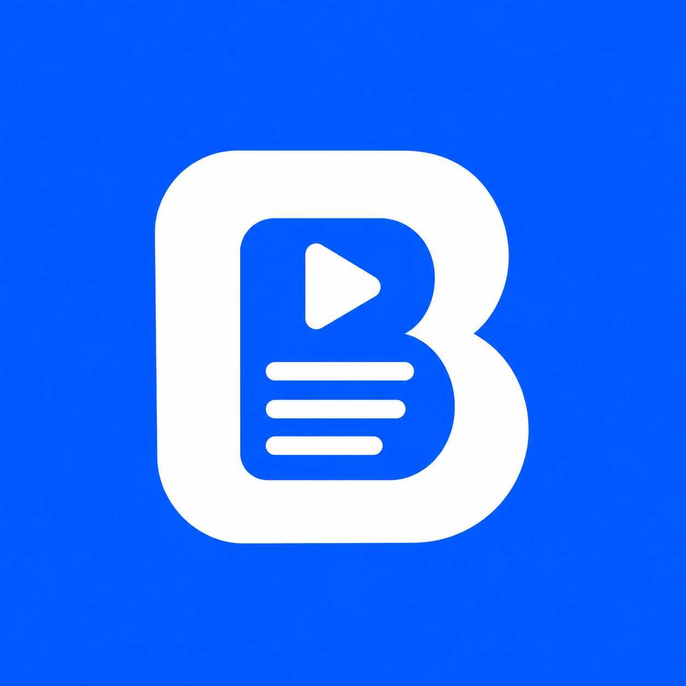
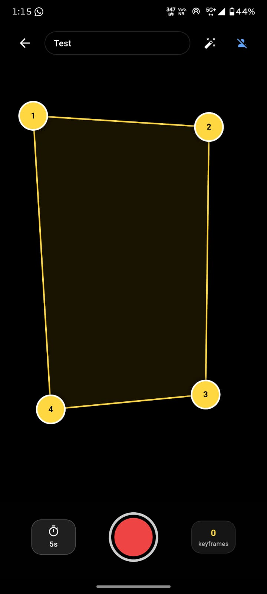
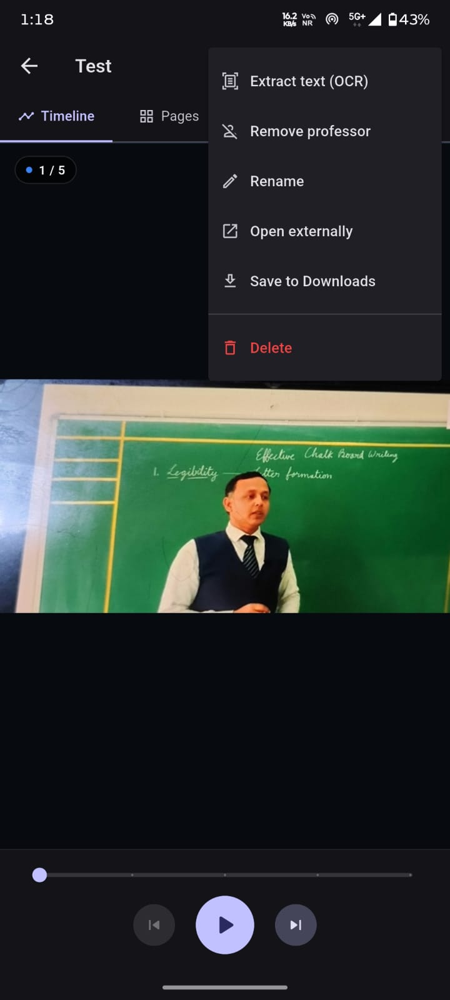
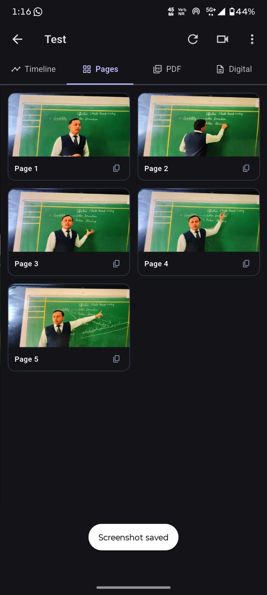
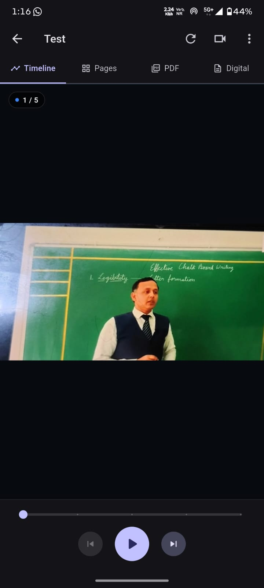
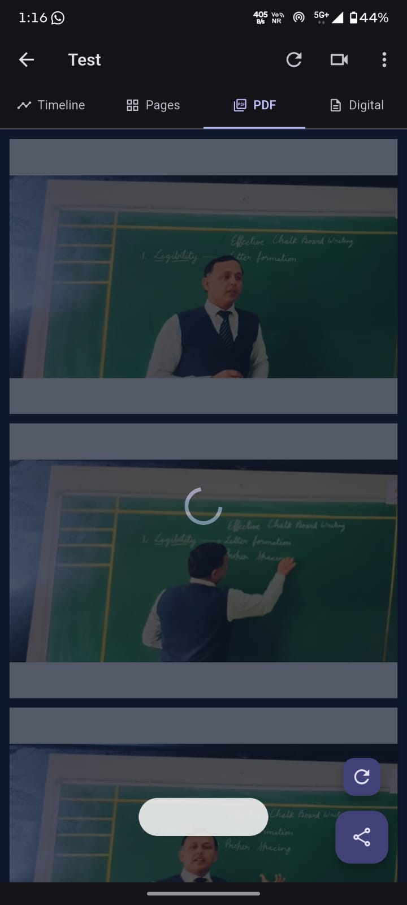
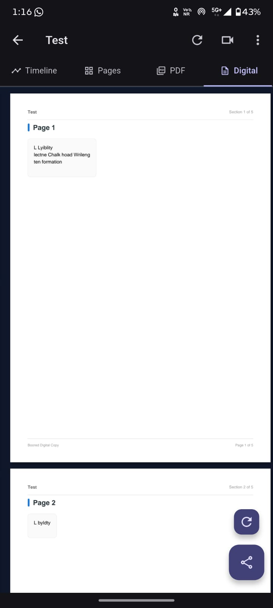

<div align="center">
  
  <h1>Boored</h1>
  <p><strong>Classroom whiteboard digitization & timeline notes for Android</strong></p>
  <p>Automated perspective rectification, pre-erase keyframing, lecturer de-occlusion, OCR extraction, and vector PDF compilation.</p>
</div>

---

## Overview

Documenting university and technical whiteboard lectures with standard phone cameras suffers from four core physical problems:

1. **Erasure Loss**: Instructors erase board sections to make space. Content wiped before someone takes a photo is gone permanently.
2. **Lecturer Occlusion**: Lecturers stand in front of diagrams and formulas, blocking 30% to 50% of the active board.
3. **Desk Perspective & Glare**: Photos taken from classroom desk angles suffer from trapezoidal distortion, lighting glare, and low ink contrast.
4. **Unorganized Photo Reels**: Standard photo galleries leave students with dozens of disconnected, out-of-order images without searchable text.

**Boored** automates the entire process on-device. It rectifies board perspective angles, triggers snapshot saves right before content is erased, removes the lecturer by sampling unobstructed background pixels across frames, extracts text with OCR, and exports both high-resolution visual PDFs and lightweight digital text documents.

---

## Features

- **Interactive 4-Corner Board Rectification**: Live camera overlay with 4 draggable normalized corner pins that snap to whiteboard boundaries. Uses native OpenCV `warpPerspective` homography to flatten angled desk shots into planar views.
- **Pre-Erase Keyframe Trigger**: Real-time OpenCV inter-frame change detection (`detectFrameChange`). When an erase event is detected (sudden luminance jump as dark ink is wiped to white), Boored automatically commits the keyframe right before the erase.
- **Multi-Frame Lecturer Removal**: On-device neural segmentation (`google_mlkit_selfie_segmentation`) tracks lecturer movement and reconstructs blocked board text by blending background pixels from adjacent frames.
- **OpenCV Adaptive Binarization & OCR**: Preprocesses frames with grayscale CLAHE and Gaussian adaptive thresholding to convert marker strokes to solid black text on clean white backgrounds before running ML Kit Latin text recognition.
- **Interactive Timeline Player**: Replay how the board developed over the course of the lecture with scrub controls, variable replay speeds (0.5×, 1.0×, 2.0×), and state markers (`INITIAL`, `ADD`, `ERASE`).
- **Pages View with 1-Tap Copy**: Browse individual de-occluded keyframes and copy formulas, code snippets, or notes directly to the mobile clipboard.
- **Dual PDF Export**: Generates both an A4 landscape visual PDF containing all high-resolution keyframes and a lightweight searchable text document (`digital.pdf`) under 200 KB.
- **Offline-First Storage**: Operates without an internet connection in class. All keyframes, timestamps, and extracted text are stored locally in Drift SQLite.

---

## Visual Workflow

| Live Capture & Rectification | Post-Processing Trigger | De-occluded Keyframes & OCR |
|:---:|:---:|:---:|
|  |  |  |
| Draggable 4-corner perspective handles | 1-tap lecturer removal & OCR | Clean board frames with text copy |

| Scrubbable Timeline Player | Vector Visual PDF Export | Searchable Digital Notes PDF |
|:---:|:---:|:---:|
|  |  |  |
| 0.5×–2.0× variable playback & event tags | Full-resolution landscape A4 pages | Text-first PDF for quick revision |

---

## Architecture & Tech Stack

```
Boored
├── apps/mobile/          # Android client (Flutter 3.x, Riverpod, Drift SQLite)
│   └── android/          # Native OpenCV 4.5.3 C++/Kotlin bridge & ML Kit
├── apps/api/             # Backend service (Hono + TypeScript on Node.js)
├── packages/db/          # PostgreSQL schema and migrations (Drizzle ORM)
├── packages/contracts/   # Zod validation contracts and OpenAPI definitions
├── infra/                # Docker Compose (PostgreSQL 16, MinIO S3 storage)
└── docs/                 # Architecture decisions & setup guides
```

### Mobile Subsystem (On-Device)
- **Framework**: Flutter 3.x with Riverpod (State Notifier pattern).
- **Target**: Android (minSdk 24, targetSdk 36).
- **Computer Vision**: OpenCV 4.5.3 (`warpPerspective`, CLAHE, unsharp mask, frame differencing) accessed via Android Kotlin `MethodChannel`.
- **Machine Learning**: Google ML Kit (Selfie Segmentation for lecturer removal + Text Recognition for OCR).
- **Persistence**: Drift SQLite database for notes, keyframes, event markers, and extracted text.
- **Document Engine**: Vector PDF generation (`pdf` and `pdfx` packages).

### Backend Subsystem (Cloud Sync)
- **API Runtime**: Hono + TypeScript on Node.js.
- **Authentication**: Google OAuth 2.0 ID token verification (`jose`), issuing JWT access tokens and rotating refresh tokens.
- **Database**: PostgreSQL 16 with Drizzle ORM and full-text search.
- **Object Storage**: S3-compatible storage (MinIO for local development, AWS S3 / Cloudflare R2 for production).

---

## Getting Started

### Prerequisites
- Node.js 20+ and `pnpm`
- Docker and Docker Compose
- Flutter 3.24+ SDK and Android Studio (SDK Platform 35/36)

### 1. Start Local Backend & Infrastructure

```bash
# Clone the repository
git clone https://github.com/r2hu1/Boored.git
cd Boored

# Install workspace dependencies
pnpm install

# Start local PostgreSQL and MinIO S3 containers
pnpm infra:up

# Run database migrations
pnpm db:migrate

# Start the Hono development server
pnpm dev
```

The API runs at `http://localhost:3000` with OpenAPI documentation available at `http://localhost:3000/v1/openapi.json`.

### 2. Run the Android Mobile App

```bash
cd apps/mobile

# Install Flutter dependencies
flutter pub get

# Generate Drift SQLite database code
dart run build_runner build --delete-conflicting-outputs

# Launch the app on an Android emulator or connected device
flutter run
```

---

## Documentation

- [Product & Technical Overview PDF](Boored_Overview.pdf): Complete 5-page illustrated document covering use cases, physical problems, computer vision algorithms, and architecture.
- [Architecture Summary](ARCHITECTURE.md): System layout and technical decisions.
- [Setup Guide](docs/setup-guide.md): Local development environment walkthrough.
- [Google Auth Setup](docs/google-auth-setup.md): OAuth 2.0 configuration, SHA-1 keystore fingerprints, and Google Cloud Console setup.
- [Progress Tracker](PROGRESS.md): Development milestones and implementation logs.

---

## License

MIT
